# Fantasy Recap

**Hide your fantasy score all week, then watch your two rosters play each other in an 8-bit game and find out who won.**

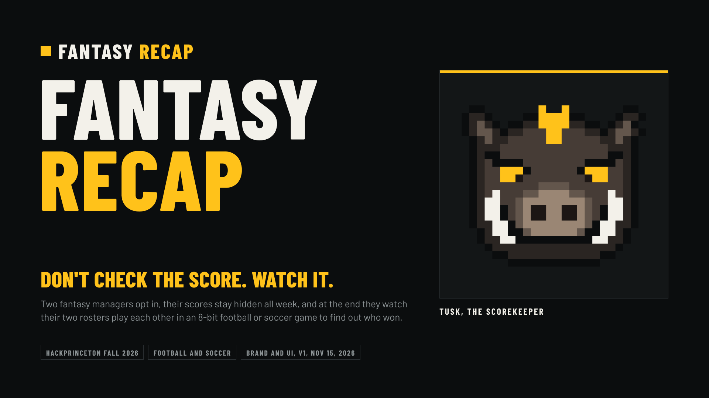

| | |
|---|---|
| Live app | https://fantasyrecap.club |
| Demo video (1:54) | https://youtu.be/7eyQpJyGEM8 |
| Devpost | https://devpost.com/software/fantasy-recap |
| Design file (Figma) | https://www.figma.com/design/JY7bLNHcuiDyEBLCpwWiba |
| Hackathon | HackPrinceton Fall 2026 |
| Team | Juan, Ricky, Peyton and Noah |

## What it does

Fantasy football managers never get to watch their own roster play together, and once you know your score there is nothing left to watch. We wanted the end of the week to feel like game day again. Two managers opt in when their matchup is set. Their scores stay hidden. At the end they watch their two rosters play each other: pixel players on a stadium field with a crowd, a play by play announcer, a halftime report that leaves out the points, speed controls. Only at the final whistle does the recap say who won, with the story of the game, the top performers and every scoring play. Soccer works the same way on its own page.

In this demo there is one viewer on one device, not two accounts, and no real week of waiting. The opt-in is kept in the browser, and also sent to our service when the page is opened with its address (the hosted app does this by itself). The players are real NFL players and footballers. The football game the app opens on is built from the real plays of NFL week 9: every catch and run these players really made, arranged into one matchup, so the fantasy points are real and the matchup and the score on the field are ours. A second football game (Goblins against Pythons) and the soccer match come from invented stat lines, so neither is a real result.

The pictures below are the frames from our design file. They show the Goblins against Pythons game.

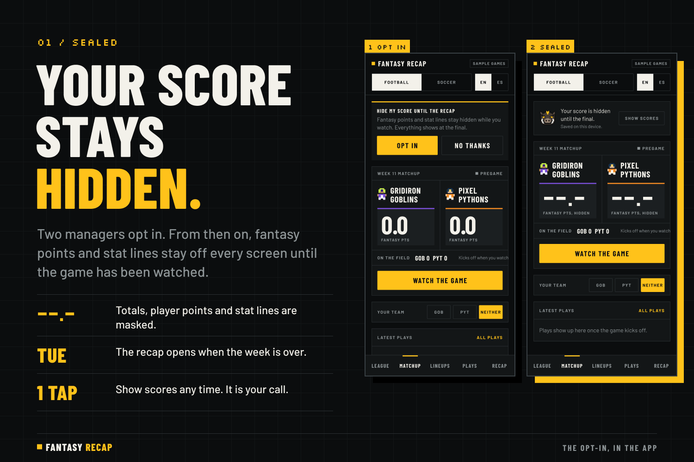

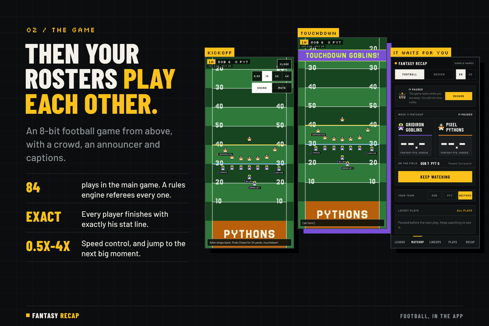

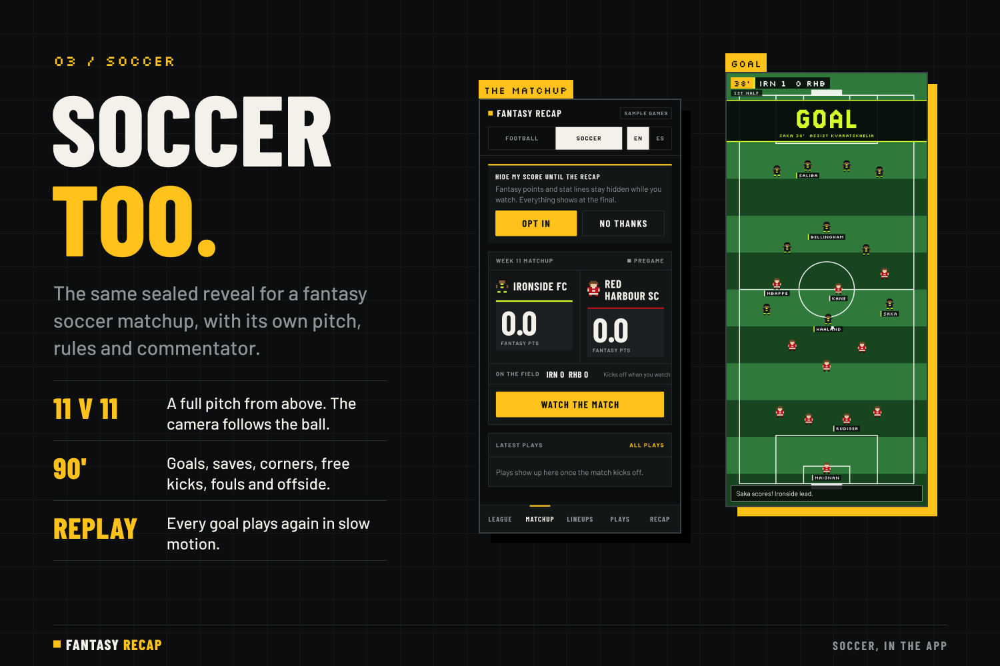

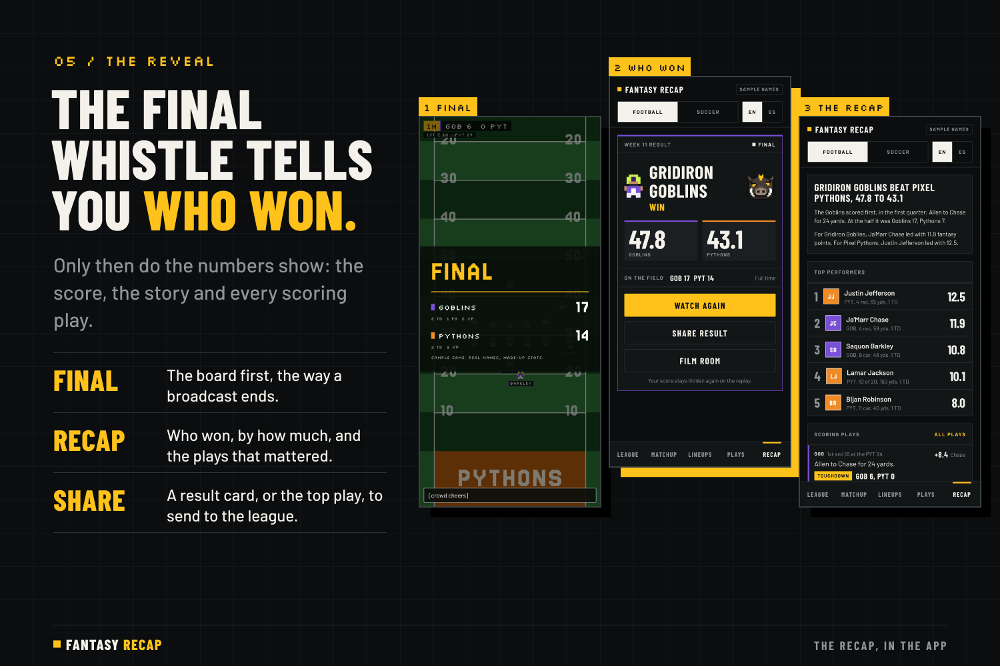

## The screens

Before the game: the league, the matchup, the lineups and the opt in.

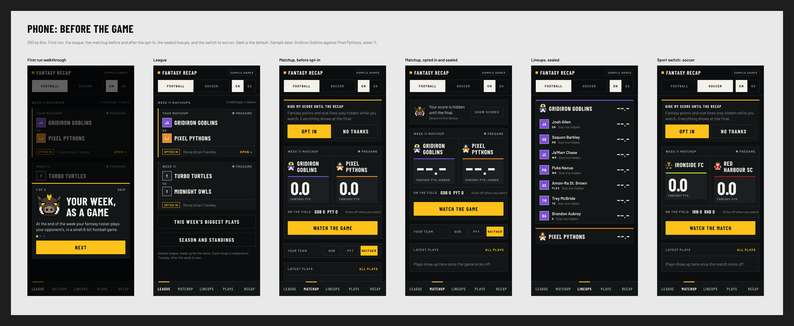

The game: football, a touchdown, soccer, the paused controls and the final.

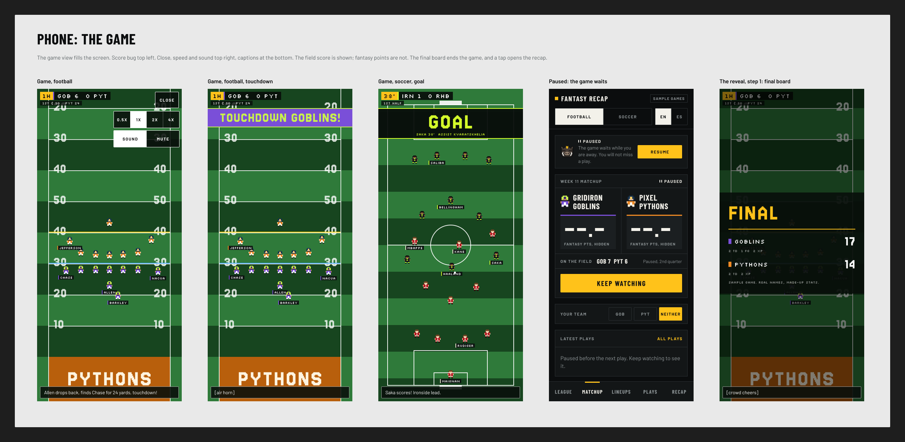

After the final: the board, the recap, the top performers and the plays.

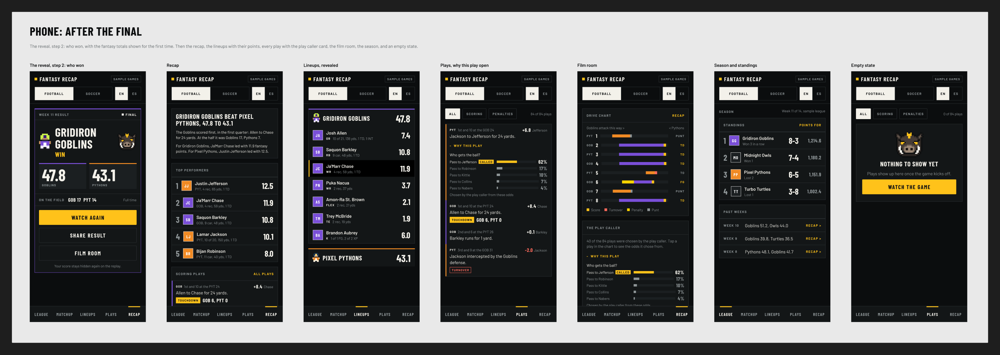

The same game on a laptop.

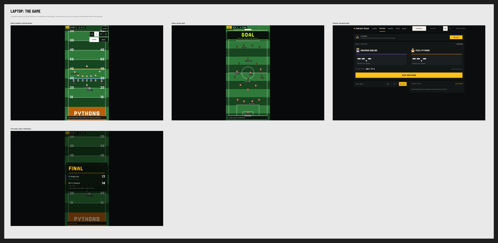

## How we built it

Four people, each directing AI coding agents on one part, coordinated through a written contract (`docs/CONTRACT.md`) and a board (`docs/BOARD.md`).

- **The app** is plain browser code with no framework and no build step.
- **A rules engine** (`js/rules.js`) works out downs, distance and score.
- **A game maker** (`engine/make-game.js`) builds a full legal game, either from a real week's plays or from target stat lines, so every player ends with exactly those numbers. A separate check replays each game and compares every number.
- **Jev** (TypeSafe AI) is the play caller for a game built from stat lines: Jev chose 40 of the 84 plays of the Goblins against Pythons game, and the rules engine refereed every play.
- **The announcer** writes its lines from templates, and the lines of the featured games are ElevenLabs recordings.
- **Scout**, a research agent, reads Sleeper and ESPN and produces player profiles and scouting reports.
- **A small Node service on Tiger Data** stores plays and serves the league, momentum, player trends and Scout's reports.

How the parts connect: `pitch/ARCHITECTURE.md`.

### Who built what

- **Juan** built soccer, and his lead session ran the project: it merged everyone's work and built the football rules engine, the game view, the game maker and the Jev link.
- **Ricky** built the players, profiles, recent form, stat lines, scoring rules, the Sleeper and ESPN cross-check, the database schema, the service, Scout, the one-command checks and the sample league.
- **Peyton** built the app screens: league, matchup, lineups, plays, recap, hidden scores, speed control and the phone polish.
- **Noah** built the announcer and the sound.

## Tiger Data

The database is Tiger Data (PostgreSQL with TimescaleDB). Every play is a row stamped with the time it happened in the game, in a hypertable. Continuous aggregates give fantasy points per player per game, per team per quarter and per player per week. Three more pieces use what TimescaleDB adds over plain PostgreSQL: momentum buckets each team's fantasy points over game time with `time_bucket`; a hypertable of fantasy awards feeds the weekly continuous aggregate that answers `GET /players/:id/trend` (week over week points and a hot streak); and `push-game` spreads games over real weeks so the weekly buckets mean something.

What ran on Tiger Data: all of it. `sh db/laptop.sh` applied the schema, the seed and every migration on the real Tiger Data service, started our service against it, pushed every football and soccer game file and called every route. The first run found two bugs: the momentum route answered with `date_bin`, because our check for `time_bucket` failed on Tiger Data (the function has many overloads), and the weekly trend came back from files, because the continuous aggregates only showed refreshed rows. We fixed both that night and ran it again: no step failed, the momentum answer said `time_bucket`, and a 19 check test against a real database (`node server/test-db.js`) passed on Tiger Data. Both run reports are in `db/runs/`.

What the app does today: it plays from a game file and reads no plays from the database. Opened with the service address it sends the opt-in, reads the league and uses the commissioner and watch party routes.

## Scout, a LangChain deep agents team

Scout (`agents/scout/`) is a deepagents team: a main agent plans with a todo list and delegates through the task tool to three subagents. The stats researcher builds a profile from Sleeper season numbers. The film room studies a player's real play by play from ESPN (3,177 snaps of the 28 roster players) and returns findings as structured claims. The fact checker verifies every cited play against the plays file and writes the report; the report writer refuses any claim without evidence and any play that is not a real play of that player. Every report claim links to the ESPN game behind it.

Offline tests run the whole team on a scripted stand-in model, including a made-up play being refused. The agent itself has run once with a real model: one player (Puka Nacua), about 2 minutes, with the main agent and all three subagents working. Its report passed the evidence check but was weaker than the one we kept. The 28 scouting reports in `data/profiles/notes/` were written by hand with Scout's tools, not by the agent, and say so on their second line. Each football team also has a team profile built the same way.

## What is real and what is simulated

**Real:** the rules engine and the check that replays every game; the player names and rosters; season tendencies and recent form read live from Sleeper, cross-checked against ESPN (all agree); 3,177 real plays and the two week 9 games built from them, one of which is the game the app opens on; the database, tested end to end on Tiger Data; Jev's play calls in the two football games built from stat lines; the ElevenLabs recordings (about 740 football lines and 280 soccer lines); 28 scouting reports with the plays behind every claim.

**Simulated:** every play of the Goblins against Pythons game, the Turtles against Owls game and the soccer match (invented stat lines, real names); in the games built from real plays, the drive starts, incompletions, penalties, the clock and the score on the field; the league and the second manager (sample data); the week of waiting.

**Not checked:** sound and speed on a real phone, the voice by ear on the demo machine, the app reading its plays from the database (it does not), one summary route that came back empty on Tiger Data, the Claude path of Scout, and a model run for 27 of the 28 players.

The full list, with the file behind every line: `pitch/REAL-AND-SIMULATED.md`. Judges' questions with honest answers: `pitch/QUESTIONS.md`.

## The brand

Tusk, the scorekeeper, keeps the score sealed all week and does not talk.

| | |
|---|---|
| 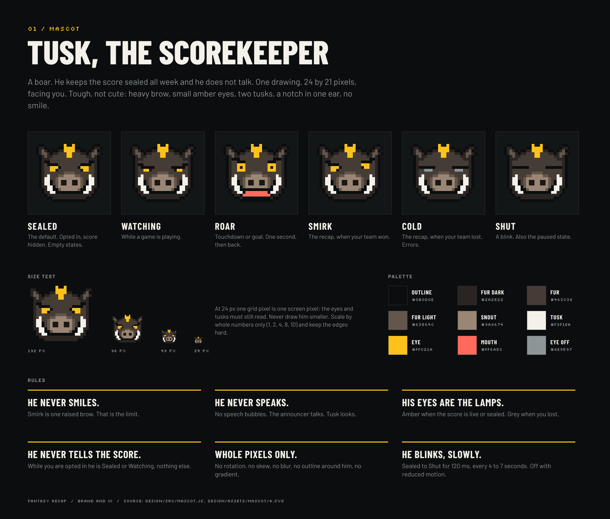 | 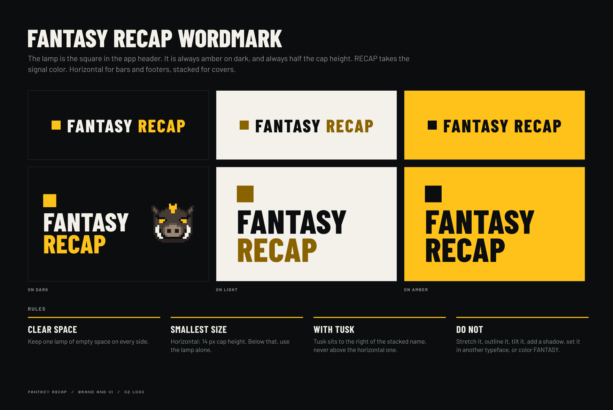 |
| 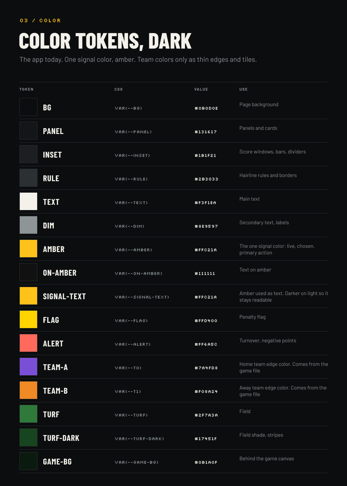 | 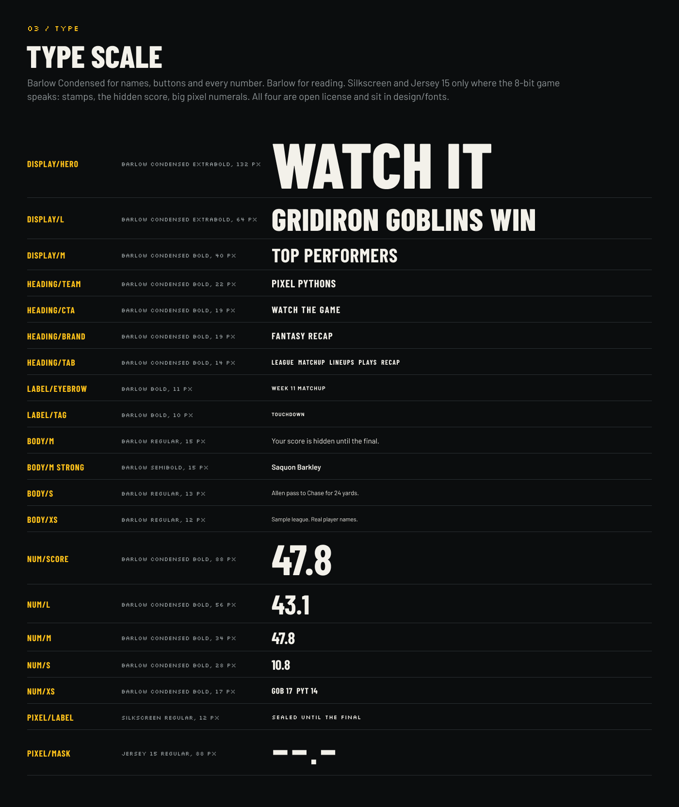 |

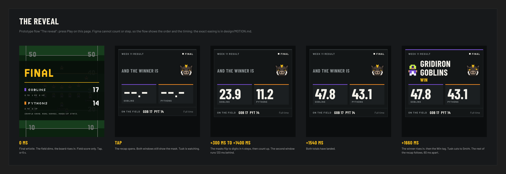

## Run it

No install and no build for the app.

```bash
python3 -m http.server 8000
```

Then open `http://localhost:8000`. On a phone, open `http://<laptop-ip>:8000` on the same Wi-Fi. Soccer: choose it with the sport switch in the app, which shows the soccer app in a frame, or open `http://localhost:8000/soccer/` by itself. Add `?game=week11-football` to the address to open the Goblins against Pythons game that Jev called.

Check everything (needs Node, no packages):

```bash
node data/checks/all.js
```

With a database (set `DATABASE_URL` to your own connection string first, never commit it):

```bash
sh db/laptop.sh
```

Then start the service with `node server/index.js` and open the app with `?api=http://localhost:3001`.

## What is in here

| Path | What it is |
|---|---|
| `index.html`, `css/`, `js/app.js`, `js/screens/` | The app: league, matchup, lineups, plays, recap |
| `js/main.js`, `js/plays.js`, `js/sprites.js` | The game view, the scripted plays, pixel players drawn in code |
| `js/rules.js` | The rules engine: downs, distance, possession, score, penalties |
| `js/data.js`, `data/` | Rosters, profiles, scouting reports, stat lines, scoring rules, game files, checks |
| `js/audio.js`, `js/announcer/`, `assets/voice/` | Sound, the announcer and its recordings |
| `js/phone.js` | Phone fixes shared by both sports: sound from the first tap, no ghost taps |
| `engine/` | The game maker and its link to Jev |
| `soccer/` | The soccer game and its own small app |
| `agents/scout/` | Scout, the research agent, its tools and its run logs |
| `db/`, `server/` | The Tiger Data schema, migrations, run reports and the Node service |
| `render.yaml`, `live.js`, `CNAME` | The hosted service on Render, its address for the hosted app, and the domain |
| `ios/` | The source of the small iPhone app that opens the live site |
| `design/`, `pitch/assets/` | The brand, the design frames and the pictures used on Devpost |
| `pitch/` | The Devpost text, the demo script, the practice page, judges' questions, real and simulated |
| `docs/`, `board/`, `handoffs/`, `tools/` | The contract between parts, who owns what, and how the team and its agents coordinated |

## Built with

Plain JavaScript in the browser. Node and the pg driver for the service. Tiger Data (PostgreSQL with TimescaleDB). Jev (TypeSafe AI) as the football play caller. LangChain deepagents, langchain-google-genai and langchain-anthropic for Scout. Gemini. ElevenLabs for the announcer. Sleeper's and ESPN's public data. GitHub Pages for the app, Render for the service, a `.club` domain from GoDaddy Registry. Claude Code and other AI coding agents for most of the code.

## What is next

Run Scout across all 28 players on a stronger model. Build a game with the filled profiles. Have the app read plays, momentum and trends from the service. Real leagues with two managers watching together, accounts, and testing on phones.
